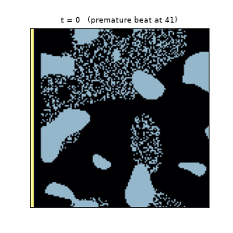
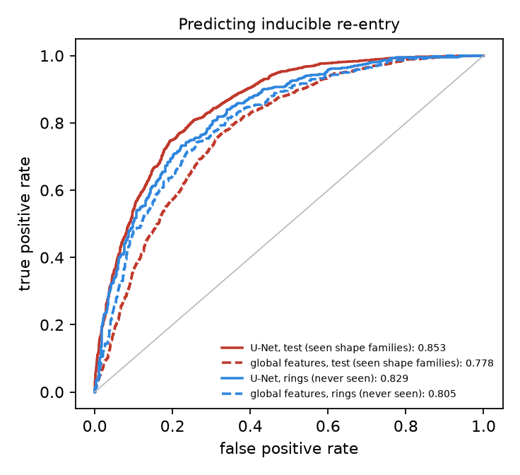
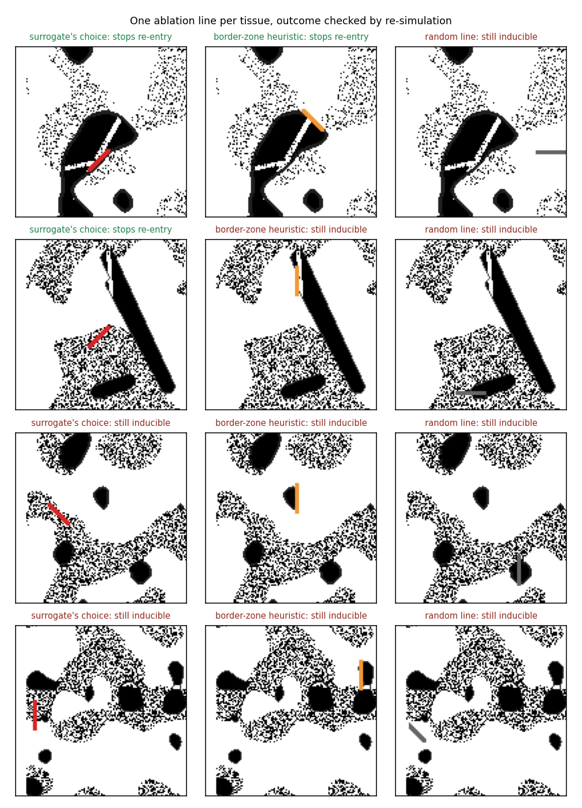

# ReentryNet

**A neural surrogate for a cardiac tissue simulator: it predicts whether a scarred piece of heart tissue
will sustain re-entry, and then picks an ablation line that stops it, checked against the simulator.**



## The question

Ventricular tachycardia after a heart attack usually runs as a re-entrant circuit around and through scar.
Research groups simulate patient-specific heart models to test whether a scar can sustain re-entry and
where to ablate. Each simulation is slow, so testing many candidate ablations is expensive.

This project builds a small, fully reproducible version of that pipeline in 2D:
1. **A simulator** that knows the physics.
2. **A neural network** that learns its answers.
3. **The network used to search ablation lines** much faster than the simulator could.

Every claim is checked against the simulator, and the targets were written down before the data existed.

## How it works

**Physics** ([`sim.py`](src/reentrynet/sim.py)):
- **Model.** Aliev-Panfilov excitable tissue on a 128 x 128 grid, from
  [CardioGrad](https://github.com/hxlvvm/CardioGrad), with anisotropic conduction along x.
- **Insulating scar.** Scar is electrically insulating: face conductances use the harmonic mean, and scar
  cells are inert. Unit tests check that a one-cell scar line blocks a wave and that a one-cell gap lets it
  through.

**Protocol:**
- An S1 plane wave from the left edge, then a premature S2 stimulus at 41, 43, 45, 48, 52 or 60 time units.
- A tissue is **inducible** if any of these intervals leaves activity running through the whole final window.
- Healthy tissue re-enters for S2 at 34-38, the classic vulnerable window, at every stimulus site tested.
  Those intervals are excluded, so every positive label is caused by the scar.

**Data:**
- 22,528 random tissues: blob and stroke scars, border zones, conduction channels and patchy fibrosis.
- Plus 1,024 **ring-shaped scars that the network never trains on**.
- Simulating all of it took 1.4 GPU-hours.
- Re-simulating with half the time step flips 1.2 % of labels, which sets a noise ceiling.

**Model** ([`net.py`](src/reentrynet/net.py)):
- A U-Net with coordinate channels: the protocol is not translation invariant, so the network has to
  know where the scar sits relative to the stimulus.
- Three seeds, averaged.

## Results (frozen model, test sets opened once; details in [`GATE_RESULT.md`](GATE_RESULT.md))

| task | U-Net | best baseline | notes |
|---|---|---|---|
| inducibility AUROC, test (4,096 tissues) | **0.853** | 0.778 (gradient boosting on scar descriptors) | target was baseline + 0.05: met |
| inducibility AUROC, **ring scars never seen** (1,024) | **0.829** | 0.806 | the advantage shrinks on new shapes |
| S1 activation map, mean abs. error (time units) | **0.72** | 1.68 (per-pixel training mean) | rings: 0.68 vs 1.62 |
| time per tissue | 0.05 s (1 CPU thread) | 0.18 s (simulator on an H100 GPU) | |



**A negative result, reported as such.** The network also predicts where re-entrant activity runs. But the
simulated "re-entry map" covers about half the tissue, so predicting *all* tissue scores a higher Dice
(0.61) than the network (0.51). That output is not used for any claim.

## Ablation planning

For each of 400 inducible test tissues, the frozen ensemble scores 1,520 candidate ablation lines (20 px long,
3 px wide) in **0.54 s** and picks the one it predicts is least inducible. The simulator then checks the
result. The plan was written down before this ran ([`ABLATION_PLAN.md`](ABLATION_PLAN.md)).

| one line per tissue | made non-inducible (re-simulated) |
|---|---|
| **surrogate's choice** | **47.8 %** (191/400) |
| line through the most border zone | 2.8 % |
| random line | 3.0 % |

- **Significance.** Paired McNemar test p = 3e-49. The lesions leave a median 0.5 % of extra tissue
  unreached by the normal beat.
- **Upper bound.** On 40 tissues, simulating about 400 lines each shows that some line works in 31 of
  them. The surrogate's single pick from that coarser set works in 11, and one of its top five works in 18.
  So the search is 15-25 times better than chance, with clear room left.
- **Winner's curse.** The surrogate is over-confident about its own picks: it predicted 37 % would stay
  inducible, and 52 % did.



## Limits

- 2D monolayer, a phenomenological cell model, synthetic scars and one pacing protocol. Times are model
  units, not milliseconds.
- Nothing here is patient-specific or clinically validated. It is a testbed for surrogate-guided ablation
  search, not a planning tool.
- The network beats hand-crafted scar descriptors clearly on familiar shapes, and only modestly on unseen
  shapes (+0.02 AUROC).

## Related work

Machine learning has been used to predict re-entry and inducibility from simulated fibrosis and scar. Two
examples:
- [Machine Learning Identification of Pro-arrhythmic Structures in Cardiac Fibrosis](https://www.ncbi.nlm.nih.gov/pmc/articles/PMC8415115/)
- [Explainable machine learning to predict anchored reentry substrate](https://www.ahajournals.org/doi/10.1161/JAHA.123.030500)

There are also reproducible inducibility-testing frameworks for cardiac digital twins, such as
[AutoVARP](https://arxiv.org/abs/2510.18635). This repository adds an open, end-to-end version with a
held-out shape family and a surrogate-guided ablation search verified by re-simulation.

## Run it

```bash
pip install torch numpy scipy scikit-learn matplotlib git+https://github.com/hxlvvm/CardioGrad
python -m pytest -q tests                                     # physics tests (CPU)
python scripts/make_dataset.py data/block_1000.npz 2048 1000 blobs,strokes   # one block (GPU)
python scripts/train.py data unet_s0.pt 30 0                  # blocks 1000-1007 needed
python scripts/evaluate.py data test results.json unet_s*.pt
python scripts/ablation.py data ablation.json unet_s*.pt
```

The three trained U-Nets are attached to the GitHub release `v1`. Simulation seeds are fixed (blocks
1000-1009 and rings 2000), so the dataset can be regenerated exactly with `scripts/make_dataset.py`.

## Licence

MIT.
